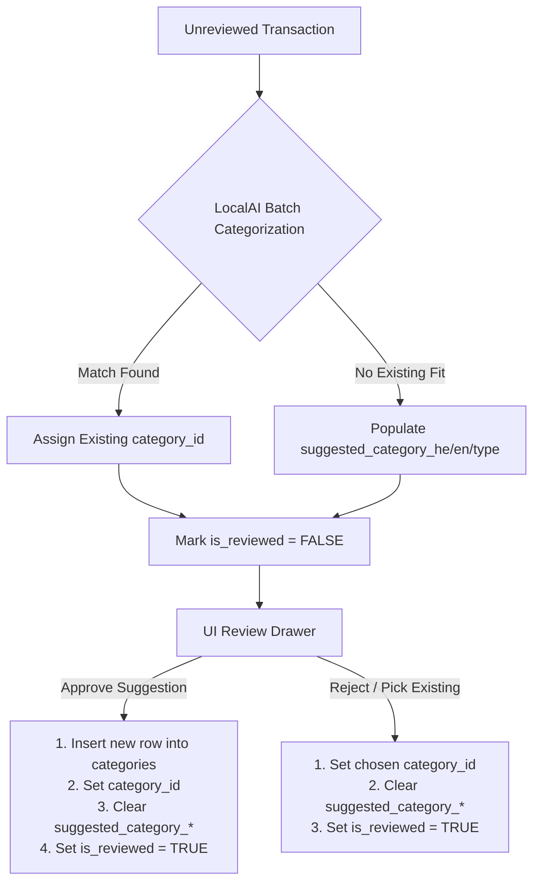

# Architectural & Implementation Review: Financial Reporting Application

**Target Specifications**:
- [`docs/SPECIFICATION.md`](SPECIFICATION.md)
- [`docs/IMPLEMENTATION_PLAN.md`](IMPLEMENTATION_PLAN.md)

---

## 1. Executive Summary

The proposed architecture for the self-hosted financial reporting application is **exceptionally well-conceived, modern, and production-ready**. Combining **Go + Echo**, **SQLite (modernc.org/sqlite CGO-free)**, **Vite + TypeScript + Tailwind CSS**, **OIDC PKCE auth**, **LocalAI batch categorization**, **MCP server support (Stdio + HTTP SSE)**, and **Taskfile.yaml** automation creates a robust, low-overhead single-binary solution ideally suited for self-hosted deployment behind proxies like Cosmos OS.

This review validates the technical specification and implementation plan across 7 key architectural domains, identifying **high-value enhancements, potential edge cases, and actionable recommendations** before code execution begins.

---

## 2. Detailed Architectural Assessment

### 2.1 Database Schema & Data Integrity (SQLite3)

> [!NOTE]
> SQLite is configured with WAL mode (`PRAGMA journal_mode = WAL;`), busy timeout (`5000ms`), and foreign key enforcement (`PRAGMA foreign_keys = ON;`). This ensures strong durability and concurrent read/write isolation.

#### Findings & Recommendations:
1. **`transactions.import_hash` Uniqueness & Overlapping File Deduplication**:
   - *Current Schema*: `import_hash TEXT UNIQUE` generated as `SHA-256(account_id | date | amount | payee_raw)`.
   - *Issue*: Pure `(account_id, date, amount, payee_raw)` hash causes collisions when two legitimate identical transactions occur on the same day. However, using raw `line_number` breaks deduplication when importing overlapping CSV files (where line numbers differ).
   - *Accepted Solution*: Use a **daily occurrence ordinal** (1-based index of matching identical items on that specific date):
     `SHA-256(account_id | date | amount | payee_raw | daily_occurrence_ordinal)`
     This preserves deduplication across overlapping CSV imports while correctly allowing multiple legitimate identical transactions on the same day.

2. **Reconciliation Table Constraints (`account_transfers`) [ACCEPTED]**:
   - *Current Schema*: `UNIQUE(bank_transaction_id, credit_card_transaction_id)`.
   - *Improvement*: Added `UNIQUE` constraint on `credit_card_transaction_id` (`CREATE UNIQUE INDEX idx_transfers_cc_unique ON account_transfers(credit_card_transaction_id);`). This enforces 1-to-Many reconciliation (1 Bank debit to N Credit Card transactions) while preventing any single Credit Card transaction from being double-settled across multiple bank debits.

3. **Transaction Split Ledger Balance Invariant**:
   - *Finding*: When a transaction is itemized into multiple categories via `transaction_splits`, the sum of split amounts ($\sum \text{split.amount}$) must equal the parent `transactions.amount`.
   - *Recommendation*: Implement an application service validation step before saving splits to reject partial or over-allocated split sums.

---

### 2.2 CSV Import & Encoding Conversion Engine

> [!TIP]
> Israeli financial statements from major institutions (Bank Hapoalim, Bank Leumi, Max, Isracard, Cal) are frequently exported in `Windows-1255` (CP1255) character encoding with inverted Hebrew directional text or custom header layouts.

#### Findings & Recommendations:
1. **Encoding Conversion**: Using `golang.org/x/text/encoding/japanese` / `charmap.Windows1255` to stream-decode bytes to UTF-8 prior to CSV parsing is optimal.
2. **Date Format Variations**: Ensure the parser handles common Israeli date conventions (`DD/MM/YYYY`, `DD/MM/YY`, `YYYY-MM-DD`).
3. **Installment Parser ("תשלומים")**:
   - Multi-month Israeli installments contain strings like `"תשלום 2 מתוך 12"` or header columns like `"מספר תשלום"` / `"סה"כ תשלומים"`.
   - Store `current_installment` and `total_installments` accurately to enable the **Subscriptions & Fixed Costs Report** to project future card payoff liabilities.

---

### 2.3 LocalAI Batch Categorization & Category Suggestion Workflow

> [!IMPORTANT]
> The AI Category Suggestion and User Approval flow solves a major UX pain point in AI-assisted bookkeeping: preventing LLMs from polluting the category tree with duplicate or slightly misnamed categories while still automating routine mapping.

#### Lifecycle Matrix:



#### Recommendations [ACCEPTED]:
1. **LLM Output Sanitization**: Strip markdown backticks (` ```json ... ``` `) before `json.Unmarshal`.
2. **Confidence Thresholding**: Store `confidence` score in response payload to highlight low-confidence items (< 0.70) in yellow within the UI review drawer.

---

### 2.4 MCP Architecture (Stdio + Echo HTTP SSE)

> [!NOTE]
> Using `github.com/mark3labs/mcp-go` enables both CLI/Claude Desktop Stdio connections (`--mode=mcp`) and web-based AI assistant tools via Echo SSE (`/mcp/sse` and `/mcp/messages`).

#### Recommendations [ACCEPTED]:
1. **Echo Compression & Buffering**: Disable Echo response buffering (`middleware.Gzip()`) for the `/mcp/` path prefix to allow instant real-time message streaming.
2. **Tool Scope**: The registered tool set (`list_accounts`, `get_account_summary`, `query_transactions`, `get_net_worth_trend`, `get_category_breakdown`, `get_subscriptions`) provides comprehensive coverage for external LLM agents.

---

### 2.5 Authentication, Security & Reverse Proxy

1. **OIDC PKCE Security**: Using OAuth 2.0 PKCE with Authentik ensures secure browser auth without storing client secrets in single-tenant deployments.
2. **Reverse Proxy Offloading**: Echo configured to extract client IP (`e.IPExtractor = echo.ExtractIPFromXFF()`) respects `X-Forwarded-For` headers from Cosmos OS.
3. **Dev Bypass (`--oidc-enabled=false`)**: Automatically injects a local admin context (`User ID: dev-admin`), facilitating fast local iteration without an active Authentik provider.

---

### 2.6 Visual Analytics & Pluggable Dashboard (10-Report Suite)

The 10 planned visual reports cover all key financial angles:
1. **Net Worth Trend** (ILS aggregate across accounts)
2. **Cash Flow Analysis** (Income vs Expenses over time)
3. **Category Donut / Sunburst**
4. **Sankey Flow Diagram** (Income $\rightarrow$ Account $\rightarrow$ Categories)
5. **Budget vs Actual** (Monthly category spending tracking)
6. **Subscriptions & Fixed vs Variable Costs**
7. **Month-over-Month Category Heatmap Matrix**
8. **Credit Card Payoff & Installments Forecast**
9. **Foreign Currency Billed Analysis** (USD/EUR original vs ILS billed fees)
10. **Anomaly & Outlier Detector** (Unusual merchant amounts or unexpected recurring debits)

---

## 3. Recommended Adjustments Summary

| Location | Item | Status / Solution |
|---|---|---|
| `docs/SPECIFICATION.md` §3 | `transactions.import_hash` | **Refined**: Hash uses `daily_occurrence_ordinal` (`SHA-256(account_id \| date \| amount \| payee_raw \| daily_occurrence_ordinal)`) for deduplication across overlapping CSV imports. |
| `docs/SPECIFICATION.md` §3 | `account_transfers` | **Accepted**: Added `UNIQUE` constraint & index on `credit_card_transaction_id` to enforce 1-to-Many reconciliation safely. |
| `internal/localai/batch.go` | JSON Parsing | **Accepted**: Strip markdown code fences (` ```json `) prior to `json.Unmarshal`. |
| `internal/mcp/sse.go` | Echo Middleware | **Accepted**: Exclude `/mcp/` path from response gzip compression/buffering. |
| `go.mod` | Go Version | **Accepted**: Target `go 1.24` / compatible version in `go.mod`. |

---

## 4. Verification Checkpoint

The specification and plan are **approved to proceed to execution**. All phases in `docs/IMPLEMENTATION_PLAN.md` are logically ordered, modular, and testable via `Taskfile.yaml`.
