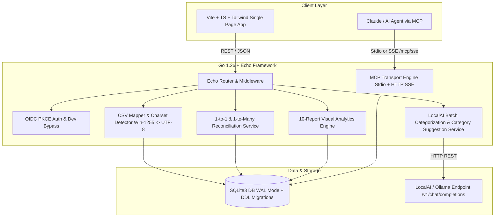

# Implementation Plan: Financial Reporting & Ledger Application

Build a production-grade, self-hosted financial reporting and ledger application in **Go 1.26** using **Labstack Echo**, **SQLite3** (`modernc.org/sqlite` CGO-free with WAL mode), **Vite + TypeScript + Tailwind CSS**, **OIDC PKCE authentication** (Authentik with dev bypass mode), **LocalAI batch categorization** with AI new category suggestion & approval workflows, **1-to-many statement payment reconciliation**, **Israeli installment tracking ("תשלומים")**, **CSV mapper with Windows-1255 auto-conversion**, **MCP server engine** over Stdio and Echo HTTP SSE (`mark3labs/mcp-go`), **10-report visual analytics suite**, and **Taskfile.yaml** automation.

---

## Architecture Overview

---

## User Review Required

> [!IMPORTANT]
> Key architectural decisions incorporated into the implementation plan:
> 1. **Deduplication Hash with Ordinal**: `import_hash` uses `SHA-256(account_id | date | amount | payee raw | daily_occurrence_ordinal)` to correctly distinguish multiple identical transactions on the same day while preventing duplicate imports across overlapping CSV files.
> 2. **Single Credit Card Transaction Settlement Invariant**: Added `UNIQUE(credit_card_transaction_id)` to `account_transfers` table to ensure 1 credit card transaction can never be double-settled across multiple bank lump-sum debits.
> 3. **AI Category Suggestion & User Approval Lifecycle**: LocalAI can suggest new categories (`suggested_category_he`, `suggested_category_en`, `suggested_category_type`). UI renders approval cards (`[ Accept & Create Category ]` / `[ Reject / Pick Existing ]`). Accepting creates the row in `categories` and links the transaction.
> 4. **Echo SSE Unbuffered Streaming**: `/mcp/` path prefix is explicitly bypassed from Gzip response compression to support unbuffered HTTP SSE transport.
> 5. **Dev Authentication Bypass**: Running `--oidc-enabled=false` automatically populates local admin context (`dev-admin`), allowing seamless offline development.

---

## Proposed Changes & Phased Implementation

---

### Phase 1: Project Setup, CLI Config, Database & Migrations

#### [NEW] `Taskfile.yaml`
- Task runner configuration for `build-ui`, `build`, `dev` (`--log-level=debug --oidc-enabled=false`), `run-mcp`, `test`, `docker-build`, `docker-up`.

#### [MODIFY] `go.mod`
- Dependencies: `github.com/labstack/echo/v4`, `modernc.org/sqlite`, `github.com/mark3labs/mcp-go`, `golang.org/x/text`.

#### [NEW] `internal/config/config.go`
- Config struct with CLI flag parsing (`--port`, `--log-level`, `--mode`, `--db-path`, `--oidc-enabled`) and environment variable fallbacks (`PORT`, `LOG_LEVEL`, `MODE`, `DB_PATH`, `OIDC_ENABLED`).

#### [NEW] `internal/logger/logger.go`
- `log/slog` structured logger with dynamic log level control (`slog.LevelVar`).

#### [NEW] `internal/models/models.go`
- Domain structs for Account, Transaction, Category, TransactionSplit, AccountTransfer, ImportPreset, CategorizationRule, Setting, and Report Data models.

#### [NEW] `internal/database/migrations.go` & `internal/database/database.go` & `internal/database/queries.go`
- SQLite WAL mode connection pool (`modernc.org/sqlite`).
- Versioned schema migration runner managing `schema_migrations`.
- SQL queries for Accounts, Transactions (with `import_hash` ordinal generation), Category creation & suggestion approval, Splits, Transfers, and Settings.

---

### Phase 2: MCP Server Engine (`mark3labs/mcp-go`)

#### [NEW] `internal/mcp/server.go`
- Registers MCP tools: `list_accounts`, `get_account_summary`, `query_transactions`, `get_net_worth_trend`, `get_category_breakdown`, `get_subscriptions`.

#### [NEW] `internal/mcp/stdio.go`
- Handles CLI stdio transport when `--mode=mcp`.

#### [NEW] `internal/mcp/sse.go`
- HTTP SSE transport handler mounted on Echo at `/mcp/sse` and `/mcp/messages`.

---

### Phase 3: Echo Web Server, Router & OIDC Security

#### [NEW] `cmd/server/main.go`
- Application entrypoint, CLI flag parsing, Echo router setup, Cosmos OS proxy trust (`IPExtractor`), static files embedded via `embed.FS`, graceful shutdown.

#### [NEW] `internal/auth/pkce.go` & `internal/auth/middleware.go`
- OIDC PKCE OAuth2 state generation & PKCE verifier validation.
- Echo session authentication middleware with `--oidc-enabled=false` dev bypass.

#### [NEW] `internal/handlers/handlers.go`
- REST Handlers: Accounts API, Transactions API, Category Suggestion Accept/Reject API, Split API, Import API, Reconciliation API, LocalAI Settings API, Reports API.

---

### Phase 4: Business Logic: CSV Engine, LocalAI Categorization, Reconciliation & Reports

#### [NEW] `internal/parser/csv.go`
- Streaming character encoding conversion (`Windows-1255` / `CP1255` $\rightarrow$ `UTF-8`).
- Header-mapped parsing, Israeli installment extraction ("תשלום 2 מתוך 12"), SHA-256 import hash with daily occurrence ordinal.

#### [NEW] `internal/services/reconciliation.go`
- 1-to-1 and 1-to-Many lump-sum statement reconciliation engine ($\sum \text{amount}_{\text{cc}} = |\text{amount}_{\text{bank}}|$).

#### [NEW] `internal/localai/batch.go`
- Go REST client communicating with LocalAI `/v1/chat/completions` (20-50 transactions per batch). Strips markdown fenced JSON, parses matched category IDs or `suggested_category` objects.

#### [NEW] `internal/services/reports.go`
- Aggregation engines for 10 visual reports: Net Worth, Cash Flow, Category Donut, Sankey Flow, Budget vs Actual, Subscriptions & Fixed Costs, MoM Heatmap, CC Payoff Forecast, Foreign Currency Billed Analysis, Anomaly Detector.

---

### Phase 5: Web UI (Vite + TypeScript + Tailwind CSS)

#### [NEW] `web/` Setup
- `web/package.json`, `web/vite.config.ts`, `web/tailwind.config.js`, `web/index.html`, `web/src/styles/main.css`.

#### [NEW] `web/src/widgets/` & `web/src/components/` & `web/src/views/`
- Pluggable Dashboard Widgets (Net Worth, Cash Flow, Category Donut, Sankey, Budget vs Actual, Subscriptions, MoM Heatmap, CC Payoff, Foreign Billed, Anomaly Detector).
- Components: Navbar, AccountCard, TransactionTable, CategorySuggestionCard (`Accept & Create`, `Reject / Pick Existing`), CSVImporter, TransferMatcher, OIDCCopyBox.
- Views: DashboardView, AccountsView, TransactionsView, ImportView, ReconciliationView, SettingsView, ExportsView.

---

### Phase 6: Docker Containerization

#### [NEW] `Dockerfile` & `docker-compose.yml`
- Multi-stage Docker build producing static Go executable with embedded Vite UI assets.

---

## Verification Plan

### Automated Tests
- `go test -v ./...` - Test DB migrations, SQL queries, CSV mapper & Windows-1255 conversion, SHA-256 ordinal hashing, LocalAI JSON suggestion parser, 1-to-many reconciliation heuristics.
- `cd web && npm run build` - Validate TypeScript compilation and Tailwind CSS bundling.
- `go build -o finrep ./cmd/server` - Validate single-binary Go compilation.

### Manual Verification
1. Launch app in dev mode (`go run ./cmd/server --oidc-enabled=false --log-level=debug`).
2. Create Bank and Credit Card accounts via UI.
3. Import sample Bank Hapoalim / Max CSV files with Windows-1255 encoding and Hebrew merchant names.
4. Trigger LocalAI batch categorization and verify pending AI Category Suggestion cards appear.
5. Click `[ Accept & Create Category ]`, verify category is inserted into SQLite and transaction updated.
6. Test 1-to-Many reconciliation linking a Bank debit to multiple Credit Card transactions.
7. Verify all 10 reports load correctly on the Pluggable Dashboard.
